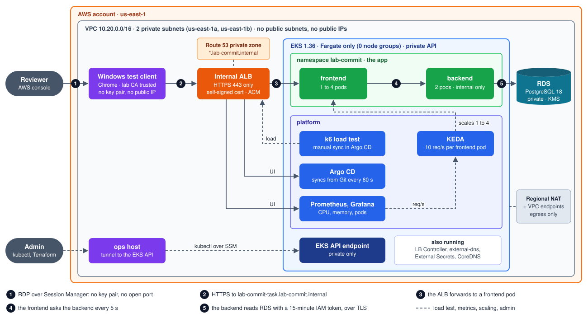
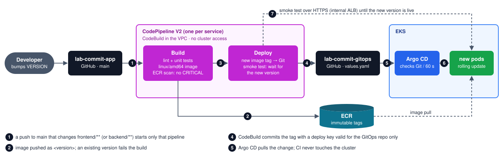
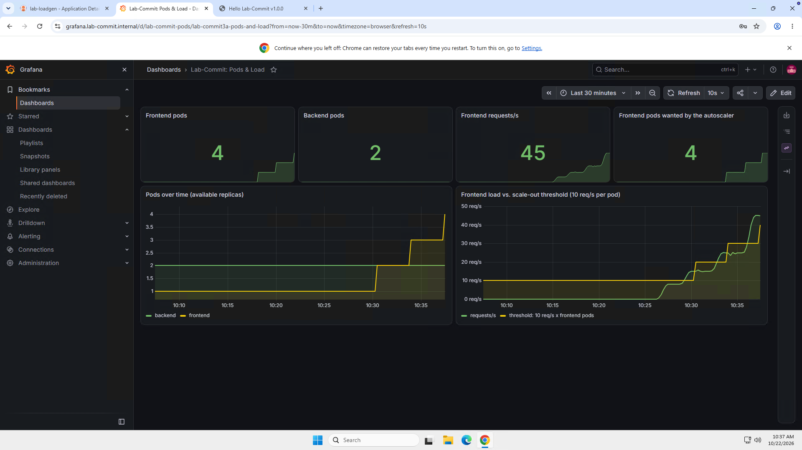
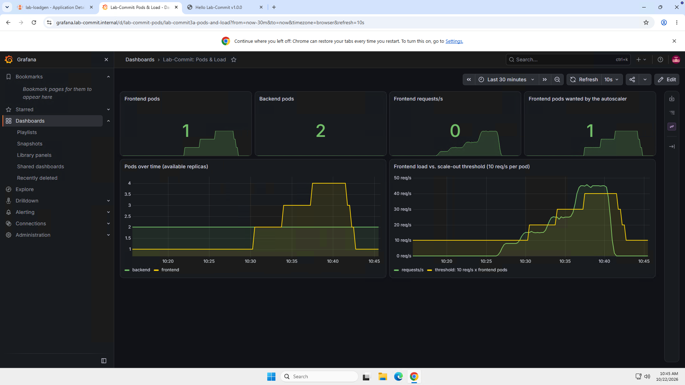
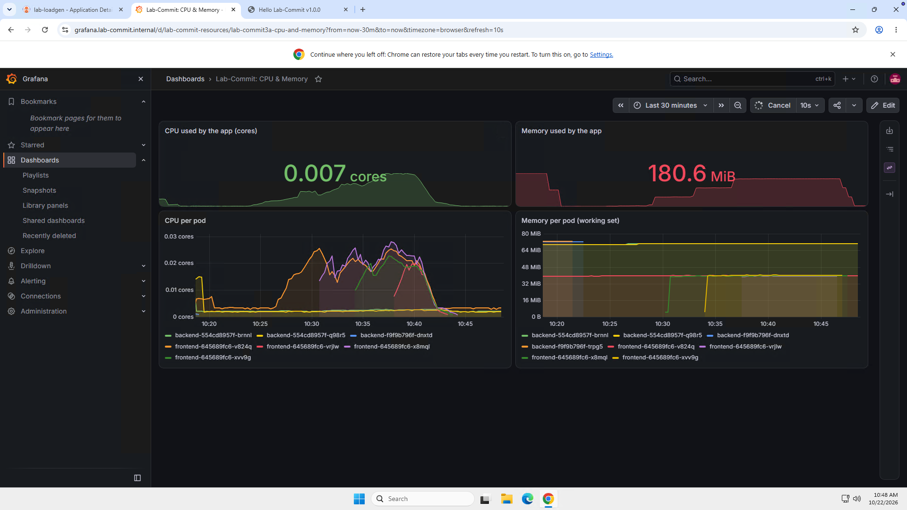
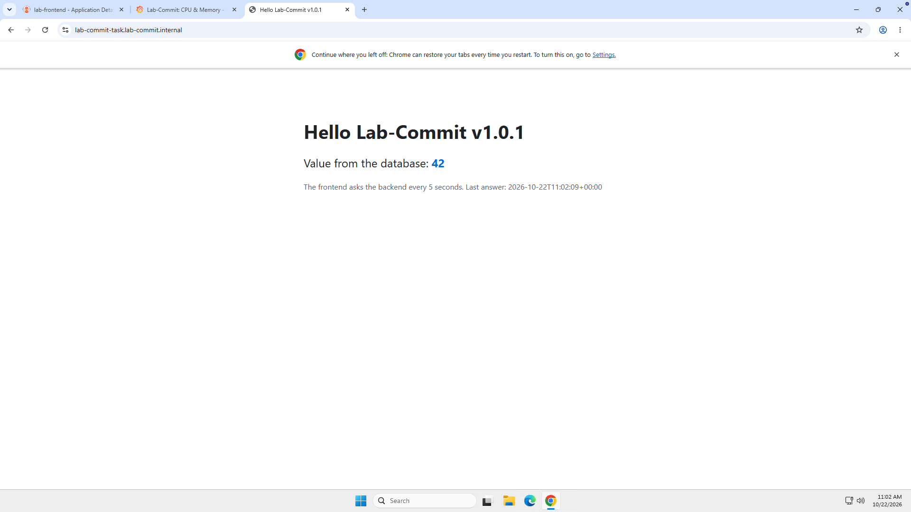

# lab-commit-infra

Commit home assignment **"AWS Lab – EKS Scaling & Pipeline"**: a private, Terraform-built AWS
environment with an EKS (Fargate-only) cluster, a Python frontend/backend reading from RDS,
GitOps delivery with Argo CD, request-based autoscaling (1 → 4 → 1 pods), monitoring, a load
generator and a CodePipeline that releases new versions.

**This is the review guide. Start here.**

| | |
|---|---|
| App (from the Windows test client) | https://lab-commit-task.lab-commit.internal |
| Argo CD / Grafana | https://argocd.lab-commit.internal · https://grafana.lab-commit.internal |
| AWS | account `788717064995`, `us-east-1`, every resource tagged `Project=lab-commit`, `Owner=candidate03` |
| Status (2026-10-22) | every requirement below deployed and verified; frontend **1.0.1** and backend **1.0.2** released by the pipelines |

Contents: [For reviewers](#for-reviewers) · [Architecture](#architecture) · [Repositories](#repositories) ·
[Requirements → how to verify](#requirements--how-to-verify) · [Demos](#demos) ·
[Security](#security) · [Access](#access) · [Deploy from scratch](#deploy-from-scratch) ·
[Day-2 operations](#day-2-operations) · [Problems found and fixed](#problems-found-and-fixed) ·
[Lab-only shortcuts](#lab-only-shortcuts-and-limitations) · [Cost and teardown](#cost-and-teardown)

---

## For reviewers

The three repositories are **public** on GitHub, so no invite is needed:
[lab-commit-infra](https://github.com/gologolo24/lab-commit-infra) (this guide),
[lab-commit-app](https://github.com/gologolo24/lab-commit-app) and
[lab-commit-gitops](https://github.com/gologolo24/lab-commit-gitops).
To see the running system you need **your own AWS access** to account `788717064995`, region
**us-east-1** (N. Virginia). No kubectl and no local tools.

1. **Get the passwords.** In the AWS console, open **Secrets Manager**, then open each secret and
   click **Retrieve secret value**:

   | Secret | For |
   |---|---|
   | `lab-commit/windows/labuser` | the Windows test client, user `labuser` |
   | `lab-commit/argocd-reviewer` | Argo CD, user `reviewer`: sees every application and may only **SYNC `lab-loadgen`** (the load test) |
   | `lab-commit/grafana-admin` | Grafana, user `admin` |

2. **Connect to the Windows test client.** Go to **Systems Manager → Fleet Manager →
   `lab-commit-windows` → Node actions → Connect → Connect with Remote Desktop**, choose
   *User credentials*, and log in as `labuser`. There is no key pair and no open port: RDP runs
   through SSM.
3. **In Chrome on Windows** (the lab CA is trusted there, so you get a valid HTTPS padlock):
   - https://lab-commit-task.lab-commit.internal is the app: "Hello Lab-Commit v1.0.1" plus the
     value from the database, refreshed every 5 s.
   - https://argocd.lab-commit.internal: log in as `reviewer`.
   - https://grafana.lab-commit.internal: dashboards **Lab-Commit: Pods & Load** and
     **Lab-Commit: CPU & Memory**.

   These names exist only inside the VPC. From the internet they don't even resolve.
4. **Run the load test yourself.** In Argo CD, open `lab-loadgen` → **SYNC** → **SYNCHRONIZE**. Then
   watch Grafana "Pods & Load" (time range *Last 30 minutes*) for about 20 minutes: the frontend
   goes 1 → 2 → 3 → 4 pods and back to 1.
5. **Everything else:** the [requirements table](#requirements--how-to-verify) gives a console or CLI
   check for every PDF item.

If the Windows instance was stopped to save cost, start `lab-commit-windows` in the EC2 console
first. It takes about 2 minutes to come back.

---

## Architecture

**How you reach the app** (runtime):



Chrome on the Windows test client resolves `lab-commit-task.lab-commit.internal` in the **private**
Route 53 zone to the **internal** ALB (②). The ALB terminates TLS with the self-signed certificate
imported into ACM, and forwards to a frontend pod (③). The frontend asks the backend every 5 seconds
(④) and serves the last answer. The backend reads the newest row from RDS with a 15-minute IAM token
over TLS (⑤). KEDA reads the request rate from Prometheus and runs 1 to 4 frontend pods. Nothing
has a public IP: people come in through Session Manager (①), and traffic leaves only through the
NAT gateway or the VPC endpoints.

**How a new version ships** (release):



1. A merged change to `frontend/**` starts only the frontend pipeline (①).
2. CodeBuild tests the code, builds the image and pushes it to ECR. The ECR scan must show no
   CRITICAL findings (②).
3. The deploy step commits the new image tag to `lab-commit-gitops` (④).
4. Argo CD pulls the change (⑤) and rolls it out (⑥).
5. The pipeline's smoke test waits until the live site reports the new version (⑦).

**CI never touches the cluster.** Its only write access is to the GitOps repo.

## Repositories

| Repo | What | Who writes |
|---|---|---|
| **lab-commit-infra** (this) | Terraform (bootstrap + 6 stacks), scripts, this guide, [docs/](docs/) | you only |
| [lab-commit-app](https://github.com/gologolo24/lab-commit-app) | FastAPI frontend and backend, tests, Dockerfiles, `VERSION` files | you; CodePipeline **reads** it (GitHub App on this repo only) |
| [lab-commit-gitops](https://github.com/gologolo24/lab-commit-gitops) | Helm 3 charts (`apps/`), platform charts (`platform/`): what runs on the cluster | you; CodeBuild **writes image tags** with a deploy key valid for this repo only; Argo CD **reads** with a read-only key |

```
terraform/
  bootstrap/          once per account: admin role, state bucket + KMS, KMS for secrets, deploy-key secret containers
  modules/            network, eks, data, access, cluster-bootstrap, cicd, irsa-role   (no account/region inside)
  envs/lab/
    env.yaml          the ONLY settings file for the lab (CIDRs, zone, versions, sizes, repos)
    10-network → 20-eks → 30-data → 40-access → 50-cluster-bootstrap → 60-cicd   (one state file each)
scripts/              tf.sh, create-tls-cert.sh, create-gitops-deploy-keys.sh, create-argocd-reviewer.sh,
                      delete-default-vpc.sh, eks-tunnel.sh, rdp-tunnel.sh, set-db-value.sh
docs/                 architecture.svg, release-flow.svg, aws-access.md, PLAN.md (original plan), screenshots/
```

CI on every PR: `terraform fmt/validate`, `tflint`, `trivy config` (infra); ruff + pytest + an
amd64 image build (app); `helm lint --strict` + `helm template` (gitops); `gitleaks` everywhere,
also as a pre-commit hook.

The repos are public, and nothing in them is secret: no passwords, keys or certificates. Every
secret lives in AWS Secrets Manager (see [Security](#security)), and gitleaks checks every commit.
Anyone can read the repos. Only the owner can push, plus CodeBuild, which can only push image tags
to the GitOps repo with its own deploy key.

---

## Requirements → how to verify

Results below were captured on **2026-10-22** with the read-only commands shown
(`AWS_PROFILE=commit-lab`, kubectl through `scripts/eks-tunnel.sh`).

| # | PDF requirement | How it's built | Verify | Result |
|---|---|---|---|---|
| 1 | Assume a role for privileged access | IAM user → `lab-commit-admin` role with **MFA**, 1 h sessions; Terraform, kubectl and the CLI use only this role. See [docs/aws-access.md](docs/aws-access.md) | `aws sts get-caller-identity` | `assumed-role/lab-commit-admin/candidate03` |
| 2 | Delete the default VPC | `scripts/delete-default-vpc.sh` (dry run by default, skips VPCs still in use) | `aws ec2 describe-vpcs --filters Name=isDefault,Values=true` | none in us-east-1 |
| 3 | VPC + 2 private subnets, routes, limited SGs | `modules/network`: 10.20.0.0/16, `/19` in 1a and 1b, no public IPs; **Regional NAT gateway** (needs no public subnet); 10 VPC endpoints; one SG per role, every rule explicit; default SG has no rules; flow logs (KMS) | `aws ec2 describe-route-tables --filters Name=vpc-id,Values=<vpc>` | subnet routes: `local`, `0.0.0.0/0 → nat-…`, S3 endpoint. **0 routes to an IGW** |
| 4 | EKS 1.36, private, **no node groups** | `modules/eks`: private endpoint only, `API` auth mode, KMS secrets encryption, control-plane logs; Fargate profiles `system` + `apps` | `aws eks describe-cluster --name lab-commit` · `aws eks list-nodegroups --cluster-name lab-commit` · `kubectl get nodes` | `1.36`, public access `False`; **0** node groups; all 26 nodes are `fargate-ip-…` (one per pod) |
| 5 | Load balancer controller + ALB with SSL termination, self-signed cert in ACM | AWS Load Balancer Controller 3.6.0 (IRSA); one **internal** ALB shared by app, Argo CD and Grafana (IngressGroup); `scripts/create-tls-cert.sh` imports the cert | `aws elbv2 describe-listeners --load-balancer-arn <alb>` · `aws acm describe-certificate --certificate-arn <arn>` | ALB `internal`; **one listener: 443 HTTPS**, `ELBSecurityPolicy-TLS13-1-2-Res-2021-06`; cert `IMPORTED`, `ISSUED` |
| 6 | Route 53 record `lab-commit-task.<zone>`, ACM | **private** hosted zone `lab-commit.internal`; external-dns (IRSA, this zone only) creates records from Ingress hosts | `aws route53 list-resource-record-sets --hosted-zone-id Z018099732BP2XLRWMPPD` | `lab-commit-task`, `argocd`, `grafana` → internal ALB; zone `PrivateZone: true` |
| 7 | Not publicly accessible; surf only the secured URL | internal ALB, private zone, no `:80` listener, ALB security group allows 443 only, no public IPs anywhere | `dig lab-commit-task.lab-commit.internal` from the laptop · ALB listeners (row 5) | does **not** resolve outside the VPC; the only listener is HTTPS 443 |
| 8 | A CD tool on the cluster | Argo CD 3.5.5 (Terraform), **ApplicationSets** generate one app per folder of the gitops repo | Argo CD UI, or `kubectl -n argocd get applications` | 6 apps `Synced/Healthy` |
| 9 | Frontend shows "Hello Lab-Commit X" (version), Helm 3 | FastAPI frontend, chart `apps/frontend` (`apiVersion: v2`) | open the URL on Windows | "Hello Lab-Commit **v1.0.1**" ([screenshot](#demos)) |
| 10 | Backend pulls from RDS; frontend pulls the backend every 5 s | backend reads `lab_values` with **IAM auth + verified TLS**; frontend polls every 5 s and the page refreshes itself | `scripts/set-db-value.sh 42` and watch the page | 5 → **42** within 5 s ([screenshot](#demos)) |
| 11 | RDS MySQL/PostgreSQL | `modules/data`: PostgreSQL 18.3, private, encrypted (CMK), TLS-only, IAM auth, master password managed by RDS | `aws rds describe-db-instances --db-instance-identifier lab-commit` | publicly accessible `False`, encrypted `True`, IAM auth `True` |
| 12 | Windows instance via SSM only, **no key pair** | `modules/access`: Windows Server 2025, no key pair, no public IP, IMDSv2, no inbound rules; SSM document installs Chrome, trusts the lab CA, creates `labuser` | `aws ec2 describe-instances` · Fleet Manager | `KeyName` empty, no public IP, IMDSv2 `required`; SSM `Online` |
| 13 | Monitoring (no CloudWatch agent): CPU and memory of the app | kube-prometheus-stack tuned for Fargate (cAdvisor through the API server, no DaemonSets); dashboards as code | Grafana → "Lab-Commit: CPU & Memory" | per-pod CPU/memory ([screenshot](#demos)) |
| 14 | 3rd-party dashboard with the number of pods | Grafana "Lab-Commit: Pods & Load" (kube-state-metrics) | Grafana | pods over time, req/s, desired vs current |
| 15 | > 10 req/s → another frontend pod, up to 4 | **KEDA** ScaledObject on Prometheus: `ceil(page loads per second / 10)`, min 1, max 4 | run the load test | 1 → 2 → 3 → **4** → 1 ([recording](#2-load-test-1--4--1)) |
| 16 | Load generator | k6 Job (manual Argo CD sync) through the real HTTPS URL, certificate verified | Argo CD → `lab-loadgen` → SYNC | 21,750 requests, **0 failed** |
| 17 | Code in GitHub; CodePipeline deploys a new frontend version | `modules/cicd`: CodePipeline V2 per service, path-filtered triggers, CodeBuild in the VPC, GitOps commit, smoke test | bump `frontend/VERSION`, merge | **1.0.0 → 1.0.1** live in ~4.5 min, smoke test green |
| 18 | Terraform, security best practice | everything above is Terraform except the 4 secret-generating scripts (by design, see [Security](#security)) | `scripts/tf.sh lab <stack> plan` | `No changes` on every stack |

---

## Demos

### 1. The app, and a database change reaching the page

| v1.0.0, value 5 | after `scripts/set-db-value.sh 42` |
|---|---|
|  |  |

`set-db-value.sh` runs `python -m app.set_value 42` as a one-off Job: the backend's image, the
`db-migrator` service account (its role may read only the RDS master secret) and the
`lab-commit/db-access` label (the Security Group for Pods that RDS accepts). The app's own DB user
stays read-only. The row was written at 10:18:13 UTC and the frontend served it on its next poll.

### 2. Load test: 1 → 4 → 1

k6 sends a fixed number of requests per second through the HTTPS ALB, in steps chosen so each
maps to a pod count (8 → 15 → 25 → 45 req/s, then 0):

| At the peak (10:37): 4 pods, 45 req/s | After the test (10:45): back to 1 |
|---|---|
|  |  |

Recorded from the cluster every 15 s (`kubectl get hpa keda-hpa-frontend`, deployment status):

| UTC | load | req/s per pod (KEDA metric) | desired → ready pods |
|---|---|---|---|
| 10:25–10:29 | 8/s | 8 | **1** |
| 10:29:34 | 15/s | 12.5 > 10 | 2 → **2** at 10:30:30 |
| 10:33:19 | 25/s | 11.9 | 3 → **3** at 10:34:15 |
| 10:36:45 | 45/s | 10.8 | 4 (5 needed, max 4) → **4** at 10:37:22 |
| 10:40:47 | k6 done | → 0 | |
| 10:41:41 · 10:42:11 · 10:42:41 | 0 | 0 | 4 → 3 → 2 → **1** (one pod per 30 s, after 60 s of lower load) |

k6 summary: 21,750 requests, 0 failed; 43,500/43,500 checks passed (HTTP 200 and the page text);
p95 latency 3.1 ms. A new Fargate pod takes ~50–60 s from decision to ready.



The app is light: under load a frontend pod used ~0.025 cores and ~40 MiB. The 10 req/s
threshold is the PDF's demo number, far below what a 0.25 vCPU pod can serve.

### 3. A release through the pipeline (frontend 1.0.0 → 1.0.1)

The only change in the PR was `frontend/VERSION`. After the merge (10:51 UTC): Build (tests,
image, push, scan) → Deploy (GitOps commit `frontend: deploy 1.0.1 to lab`) → smoke test saw
`/version = 1.0.0` until 10:55:17 and **`1.0.1` at 10:55:32**.



---

## Security

**Identity and least privilege.** No long-lived AWS keys are used anywhere: people assume a role
with MFA, pods use IRSA, AWS services use service roles with confused-deputy conditions
(`aws:SourceAccount`/`aws:SourceArn`).

| Identity | May do | Notes |
|---|---|---|
| `lab-commit-admin` (people) | admin, after MFA | only EKS cluster-admin (access entry); 1 h sessions |
| `lab-commit-irsa-backend` | `rds-db:connect` as `app_reader` | `app_reader` may only `SELECT` from `lab_values` |
| `lab-commit-irsa-db-migrator` | read the RDS master secret | used by the migration and `set-db-value` Jobs |
| `lab-commit-irsa-eso-{argocd,monitoring,loadgen}` | read **one** secret / parameter each | one External Secrets store per namespace |
| `lab-commit-irsa-aws-load-balancer-controller` | the controller's official v3.6.0 policy | tag-conditioned |
| `lab-commit-irsa-external-dns` | change records in the **lab zone only** | |
| `lab-commit-codebuild-<svc>-build` | push to **its own** ECR repo | |
| `lab-commit-codebuild-<svc>-deploy` | read the GitOps write key and the lab CA | **no cluster access** |
| `lab-commit-codepipeline-<svc>` | use the GitHub connection, start its own 2 builds | |
| Windows / ops instance profiles | SSM; Windows also its own password secret and the CA | |
| Argo CD, KEDA, Prometheus, Grafana | **no AWS permissions** | |
| Argo CD user `reviewer` | read everything, **sync `lab-loadgen` only** | Argo CD RBAC; no other user has a default role |

**Network.**
- No public subnets, no public IPs, no inbound rules on any instance. Internet egress only through
  the NAT gateway; AWS APIs through VPC endpoints.
- The EKS API is private; admins reach it through an SSM tunnel (TLS still verified).
- NetworkPolicy isn't enforced on Fargate, so **Security Groups for Pods** are used instead:
  - RDS accepts 5432 only from the `backend-pods` SG, which only backend and migration pods get.
  - The ALB accepts 443 only from the Windows client, the `loadgen-pods` SG and CodeBuild.
- TLS everywhere: ALB with a TLS 1.2/1.3 policy, `sslmode=verify-full` to RDS (CA bundle baked into
  the image with a pinned checksum), k6 and the smoke test verify the lab CA.

**Secrets: none in Git, none in Terraform state.**
- RDS master password: generated and kept by RDS in Secrets Manager.
- The app has **no password at all**: it signs 15-minute IAM tokens.
- Grafana and Windows passwords: write-only Terraform arguments from ephemeral `random_password`, so
  they reach Secrets Manager without being stored in state.
- GitOps deploy keys: generated by `scripts/create-gitops-deploy-keys.sh` straight into Secrets
  Manager. Argo CD gets the read-only key through External Secrets. The CodeBuild write key never
  enters the cluster.
- TLS: `scripts/create-tls-cert.sh` imports the server key into ACM and **throws the CA key away**,
  so nobody can mint more trusted certificates. The CA *certificate* (public) lives only in SSM.
- Argo CD reviewer: `scripts/create-argocd-reviewer.sh` writes the password to Secrets Manager.
  Argo CD gets only its bcrypt hash.
- gitleaks runs in CI and as a pre-commit hook in all three repos.

**Workloads.**
- Every pod runs under Pod Security `restricted`: non-root, read-only root filesystem, no
  capabilities, `RuntimeDefault` seccomp.
- No service-account token is mounted where it isn't needed.
- Images: pinned base digests, built by CodeBuild for linux/amd64, scanned by ECR (CRITICAL stops
  the release). Tags are immutable, so each version is built exactly once.

**Supply chain of the pipeline.**
- The buildspecs live in **this** repo, not the app repo, so a change to the app code can't change
  what CI does with its permissions.
- `yq` is downloaded with a pinned SHA-256, and GitHub's SSH host key is pinned.

## Access

All access goes through AWS Systems Manager. Details in [docs/aws-access.md](docs/aws-access.md).

| What | How |
|---|---|
| CLI / Terraform | profile `commit-lab` (role `lab-commit-admin`, MFA) |
| kubectl | `scripts/eks-tunnel.sh` (keep open), then `kubectl --context lab-commit …` |
| Windows test client | `scripts/rdp-tunnel.sh` + Windows App → `localhost:53389`, or Fleet Manager → Remote Desktop. User `labuser`; password: `aws secretsmanager get-secret-value --secret-id lab-commit/windows/labuser` |
| Grafana login | `aws secretsmanager get-secret-value --secret-id lab-commit/grafana-admin` |
| Argo CD login | reviewers: `reviewer`, password in secret `lab-commit/argocd-reviewer`. Admin: `admin`, password: `kubectl -n argocd get secret argocd-initial-admin-secret -o jsonpath='{.data.password}' \| base64 -d` |

## Deploy from scratch

Tools: Terraform ≥ 1.11, AWS CLI v2 + session-manager-plugin, kubectl 1.36, Helm 3, gh, jq,
yq, OpenSSL 3. AWS profiles as in [docs/aws-access.md](docs/aws-access.md).

1. **Account bootstrap** (once per account; first run as the IAM user, then as the role):
   `terraform -chdir=terraform/bootstrap init -backend-config=backend.hcl && terraform -chdir=terraform/bootstrap apply`
2. **Keys and certificate**:
   - `scripts/create-gitops-deploy-keys.sh` (needs `gh auth login`)
   - `scripts/create-tls-cert.sh`
   - `scripts/delete-default-vpc.sh --delete us-east-1`
3. **Stacks**, in order: `scripts/tf.sh lab 10-network apply`, then `20-eks`, `30-data`, `40-access`.
4. **Cluster bootstrap**: start `scripts/eks-tunnel.sh`, then `scripts/tf.sh lab 50-cluster-bootstrap apply`.
   Argo CD then installs everything in `lab-commit-gitops` by itself. Then run
   `scripts/create-argocd-reviewer.sh` to set the reviewer login.
5. **CI/CD**: `scripts/tf.sh lab 60-cicd apply`. Then, **once, in the console**: Developer Tools →
   Settings → Connections → `lab-commit-github` → *Update pending connection*, and install the
   AWS Connector GitHub App on `lab-commit-app` **only**.
6. **First release**: push `frontend/` and `backend/` changes to `lab-commit-app/main` (or start
   the pipelines). The images appear in ECR and Argo CD deploys them.

A new environment is `cp -r terraform/envs/lab terraform/envs/<new>` plus a new `env.yaml`, and an
`envs/<new>/values.yaml` per chart in the gitops repo (plus an `env` label on the target cluster).

## Day-2 operations

| Task | How |
|---|---|
| Release the frontend/backend | bump `<service>/VERSION` in `lab-commit-app`, merge. The pipeline refuses a version that already exists, and "Retry" of the same commit is safe |
| Change the database value | `scripts/set-db-value.sh <n>` (tunnel running) |
| Run the load test | Argo CD → `lab-loadgen` → SYNC (no FORCE). The previous run is replaced. Watch Grafana "Lab-Commit: Pods & Load" |
| Rotate the Windows / Grafana password | bump `windows_password_version` / `grafana_password_version` in `env.yaml`, apply |
| Rotate the GitOps deploy keys | `scripts/create-gitops-deploy-keys.sh` |
| Rotate the Argo CD reviewer password | `scripts/create-argocd-reviewer.sh` (tunnel running) |
| Renew the TLS certificate | `scripts/create-tls-cert.sh`: re-imports into the same ACM ARN and publishes the new CA to SSM. k6 and the pipeline read the CA on every run; Windows trusts it on its daily setup run (or run the `lab-commit-windows-setup` association now) |

## Problems found and fixed

Real issues hit while building this, kept here because they show how the parts behave.
Each one is fixed in the code.

| Symptom | Cause | Fix |
|---|---|---|
| First pipeline runs failed after pushing the image | `aws ecr wait image-scan-complete` fails at once if the scan isn't registered yet | the build polls the scan status; images also get a `commit-<sha>` tag, so a retry of the same commit skips the rebuild |
| `db-migrate`: `root certificate file … does not exist` | `ADD --chmod=0644` also gave the new folder `/app/certs` mode 0644, and the app user couldn't enter it | create the folder first; the image build now **fails** if the app user can't load the CA (released as backend 1.0.1; versions are never reused) |
| Argo CD kept running the broken 1.0.0 migration after 1.0.1 was committed | Argo CD retries an operation on its **original** revision | the first, never-healthy sync was terminated once by hand. In steady state an unrelated commit doesn't touch a healthy app |
| Grafana "No data", HTTP 503 during the load test | 1 GB Fargate pod. Fargate counts only declared requests, and Grafana's sidecars had none (~807 MiB used) | Grafana 2 GiB plus sidecar requests, so a 3 GB pod |
| Grafana CrashLoopBackOff at 0.25 vCPU | plugin loading took > 2.5 min, and the liveness probe killed it | 0.5 vCPU, liveness starts after 120 s |
| Prometheus Operator and External Secrets failed on Fargate | both default to port 10250, which Fargate's kubelet uses | moved to 10260 / 9443 |

## Lab-only shortcuts and limitations

- RDS: single-AZ, deletion protection off, no final snapshot; ECR `force_delete`; S3 `force_destroy`.
  Each is deliberate so the lab can be torn down in one go. Production would flip all of them.
- One environment (`lab`) in one account. The layout supports more (`envs/<env>`, ApplicationSets
  matrix by cluster label), but only `lab` exists.
- The account is **shared** with other candidates, so nothing account- or region-wide was changed:
  the Session Manager default document, EBS default encryption and the registry scanning mode are
  all left as they were. Our session settings are in our own document `lab-commit-shell`.
- Self-signed CA: browsers trust it only where the CA was installed (the Windows client, k6, the
  smoke test). Renewing creates a new CA, which those clients pick up from SSM.
- Prometheus keeps 2 days of data on an emptyDir (Fargate has no EBS). It is lost if the pod
  moves; fine for a lab.
- Argo CD polls Git every 60 s; it can't receive GitHub webhooks because it's private. So a
  release takes ~4–5 min end to end.
- A Grafana rollout can briefly return HTTP 504 while the ALB drains the old pod. The upstream
  chart has no preStop hook. The app's own frontend avoids this with a preStop sleep and a 30 s
  drain.
- The 10 req/s scale-out threshold comes from the PDF. Real capacity per pod is much higher.

## Cost and teardown

Rough on-demand estimate: **~$20–25/day**. The main items are the ~25 Fargate pods (one small VM
each), 9 interface VPC endpoints × 2 AZs, the Windows instance, the EKS control plane and the NAT
gateway. To save money between reviews, stop the Windows instance
(`aws ec2 stop-instances --instance-ids i-01af55c486191699c`).

Teardown (order matters, or the VPC delete waits on the ALB's network interfaces). Not yet
rehearsed end to end:
1. `kubectl -n argocd delete applicationsets --all`, so nothing re-creates resources. The
   generated applications go away; the workloads stay.
2. `kubectl delete ingress -A --all`. The controller deletes the ALB, and external-dns
   (`policy: sync`) deletes its records. Wait until `aws elbv2 describe-load-balancers` no longer
   lists `k8s-labcommit-…`.
3. `scripts/tf.sh lab <stack> destroy` for `60-cicd`, `50-cluster-bootstrap` (tunnel running), `40-access`,
   `30-data`, `20-eks`, `10-network`.
4. `terraform/bootstrap` last; empty the versioned state bucket first.
